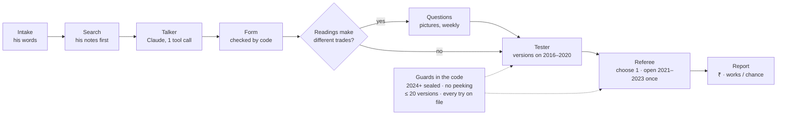
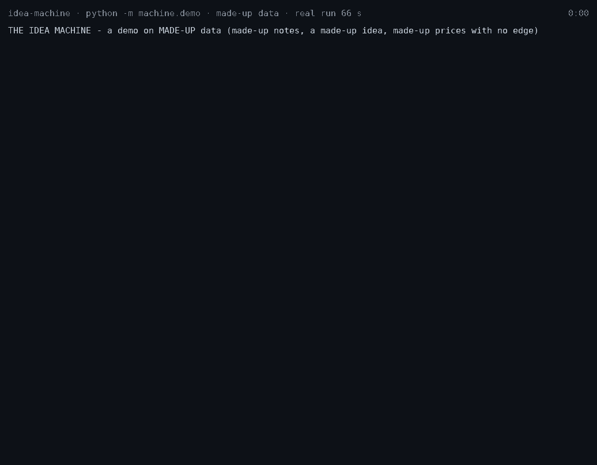
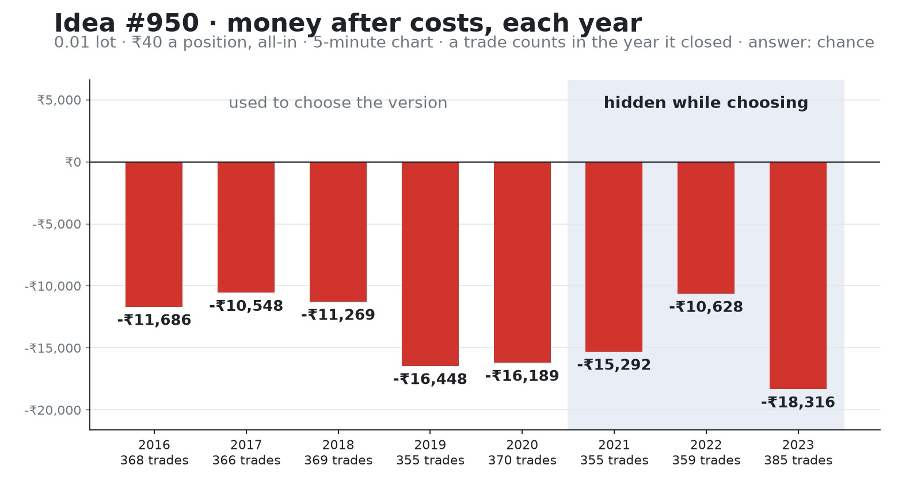

# idea-machine

**An AI agent that turns a gold trader's plain-English idea into a testable rule, and a referee written in code
that decides, honestly, whether the rule works.** The AI writes rules; code judges.

> This is the public copy of a private working repo. The trader's own notes, his ideas and the gold price data stay
> private ([PRIVATE-PARTS.md](PRIVATE-PARTS.md)). Everything here runs on made-up data.

## The problem

1. A trader has dozens of ideas in plain words ("sell when the London high is taken, then the break and the first
   gap, sell at the gap"). Testing each one by hand on years of 1-minute prices is slow, and it is easy to fool
   yourself: try 20 variations and one will look good by luck.
2. A language model can write a backtest, but a backtest an AI writes freely cannot be trusted. It can peek at the
   future, quietly change the rule, or keep the lucky version.
3. So here the model only fills in a strict **form**, and asks the trader only what his notes don't already answer.
   Ordinary tested code compiles, tests and judges the form, using rules written down **before** any result.

## How it works, in 5 steps

1. **Say the idea** in plain words, on Telegram or in a session.
2. **Search first.** Every term is searched in the trader's notes (BM25 + embeddings, an explicit order of trust).
   What is already written is never asked again.
3. **A form, not code.** Claude makes one strict tool call that fills an idea form. Code checks it: real building
   blocks, the trader's 19 fixed rules untouched, every citation real. Parts the words leave open are marked **ASK**
   (only he knows) or **VERSION** (the machine tries each).
4. **Ask only where readings disagree.** A question goes to him (with pictures, in one weekly batch, no money shown)
   only when the readings make different trades.
5. **Test and judge.** Every version is replayed on 2016–2020 1-minute gold, with his real cost (₹40 per position at
   0.01 lot, all-in). The referee chooses one version, opens 2021–2023 **once**, and answers in rupees: *works*,
   *chance*, *chance — needs fresh years*, or *not enough trades to tell*.



The design and where each rule is enforced: [docs/DESIGN.md](docs/DESIGN.md).

## Run it on made-up data

Python 3.13.

```bash
git clone https://github.com/Tejas1024/idea-machine.git
cd idea-machine
python -m venv .venv
.venv/bin/python -m pip install -r requirements.txt        # Windows: .venv\Scripts\python
.venv/bin/python -m pytest -q                               # a fresh clone, 10 Oct 2026: 1417 passed, 420 skipped
.venv/bin/python -m machine.demo                            # every step on made-up data, about 2 minutes
.venv/bin/python -m machine.demo --full                     # + the referee's real answer and the report, about 20 minutes
```



*The demo, recorded (`python -m machine.demo.record docs/demo.gif`; the script: [plan/work/demo-script.md](plan/work/demo-script.md)).*

The skipped tests need files that are not in this copy, and `pytest -rs` names each one: 306 need private files
(161 of them use the trader's first idea as their fixture), and 114 need the real prices, the news calendar, MT5,
PyTorch's image package (`requirements-eyes.txt`) or the search model. The demo uses only `tests/data/demo/`: made-up notes, a made-up idea, a talker answer written by hand in
the exact shape Claude returns (so no API key is needed), and a random walk of 3 million 1-minute bars with **no
edge in it**, so the honest answer is *chance*. What it prints (abridged, a real run):

```text
==== 3. THE AI WRITES A FORM, CODE CHECKS IT ====
form: sell after a high is taken, the break and the first gap · 5m chart · sell
  step sweep  sweep                a session high is taken (a wick is enough)
  step brk    break_of_structure   break of structure down, soon after
  step gap    gap_of_the_move      the first gap of the breaking move
code's checks: status FORM DRAFTED · problems 0 · citations not among the quotes shown 0 · sanity checks failed 0
  unclear U1 'which high counts': ASK him (only he knows what he means)
  unclear U2 'how soon the break must come': VERSION (the machine tries each)
a form that enters at the FAR edge of the gap instead: REFUSED
    - entry.at: 'where_in_the_gap_he_buys' cannot be set to 'gap.far': it is FIXED - what a thing IS, not a rule to test

==== 4. ASK ONLY WHERE THE READINGS MAKE DIFFERENT TRADES ====
U1 'which high counts' on 2019-01..2019-03 (made-up prices): reading A 96 setups, reading B 42, the same in both 42
  -> different trades: the question goes into his weekly batch (with A / B pictures, no money shown)

==== 5. TEST EVERY VERSION, IN RUPEES AFTER COST ====
  v-c9a68d636f the break within 30 five-minute bars (2.5 hours): 355 trades, won 15.2%, -₹45 a trade, -₹16,080 in all (cost ₹14,200)
  v-3d23dff06e the break within 12 five-minute bars (1 hour): 257 trades, won 15.6%, -₹46 a trade, -₹11,935 in all (cost ₹10,280)

==== 6. THE REFEREE: RULES FIXED IN ADVANCE, AND ITS OWN EXAM ====
  100 ideas with no edge (they lose the ₹40 cost): 'works' 0 of 100
  100 ideas with the hardest noise (exactly ₹0 a trade after cost): 'works' 6 of 100
    (if all 20 versions were judged on the same years and the best one kept: 'works' for 64 of 100 - why the check years open only ONCE)
  200 ideas with a real ₹50 edge a trade: 'works' 142 of 200
  200 ideas with a real ₹100 edge a trade: 'works' 198 of 200

==== 7. THE GUARDS (CODE, NOT PROMISES) ====
ask for March 2024 -> REFUSED: This touches 2024-03-31 00:00:00; the sealed years start 2024-01-01. ...
a level from the NEXT hour's high -> CAUGHT: cut at 2019-01-02 05:00:00: 'high' at 2019-01-02 04:10:00 is 1042.44 with the future and nan without it. ...
test on 2021 before a version is chosen -> REFUSED: The check years (2021) stay hidden while choosing and open ONCE per idea
```

The full run (`--full`, 20 minutes) chooses one of the two versions on 2016–2020, opens 2021–2023 once for it, and
judges. On prices with no edge, the right answer is *chance*, and that is what it says:

```text
  v-c9a68d636f | the break within 30 five-minute bars (2.5 hours) | 1828 | -₹36 | -₹66,140 | 0.00  <- chosen
  v-3d23dff06e | the break within 12 five-minute bars (1 hour) | 1326 | -₹37 | -₹48,703 | 0.00
  compiled 2016-2023 in 226 s: 2061 signals up to 2020 (the same as the tune), 1219 in 2021-2023

ANSWER: CHANCE — failed: luck test, random entries, fake levels, without the best 3
Money after costs, 0.01 lot: -₹13,228 a year (2016–2020, the best of 2 versions there) · -₹14,745 a year (2021–2023, hidden while choosing)
Worst year: -₹18,316 (2023, 385 trades) · of 2016–2020: -₹16,448 (2019) · without the best 3 trades: -₹42 a trade
Versions tried: 2 of 20 · slices chosen before: 0 of 8 · looked at, not tested: 0
Smallest edge this test could see: ₹10 a trade (caught at least half the time with 1099 trades)

The 6 checks (the rules were fixed before any result was seen):
1. luck test: NO — -₹40 a trade; a world with no edge gives this much 100.0 times in 100 (needs under 5, and above ₹0)
2. random entries: NO — it beats 64 of 100 random runs (needs 95); random runs: middle -₹42 a trade, 1090 trades (this idea 1099)
3. fake levels: NO — it beats 5 of its 8 fake levels (needs 75 in 100)
4. without the best 3: NO — -₹42 a trade without its best 3 trades (needs above ₹0)
5. trades: yes — 1099 trades (needs 30)
6. not already seen: yes — not in the old project's list
```



Every year loses about the ₹40 cost a trade, because there is nothing to find. The whole run's output:
[docs/demo-full-run.md](docs/demo-full-run.md).


## Results so far (on real gold, 2016–2023)

Every number below comes from a trial file in the private repo. There is one file per test run (236 so far,
10 Oct 2026), so every try is counted. Money is in rupees at 0.01 lot, after the ₹40 cost per position.

**The trader's ideas.** Each one went through the same path: his words → a checked form → 3 example setups he
confirmed on a picture → up to 20 versions on 2016–2020 → one version chosen → 2021–2023 opened once.

| What was tested | Tries | Answer | The numbers |
|---|---|---|---|
| **Idea #1**, the trader's usual setup (grab → break → first gap, 7 steps) | 18 of 20 versions on 2016–2020; check years opened once | **chance** | 2021–2023: −₹119 a trade on 260 trades, every year lost, worst 2021 −₹12,636 · worse than 196 of 200 random-entry runs and all 8 fake levels |
| Idea #1 with his own hedging (the hedging tester) | 1 version, 2016–2020, his entries vs 200 random | **no better than random** | his entries −₹12,244 (15 trades, 478 positions; +₹6,876 before cost) · random entries with the same hedging −₹13,352 · his entries beat 100, 95, 102, 131, 166 of 200 by year · idea #1 dropped by the rule written before the test |
| **Idea #2**, sell or buy at the edge of the day's average-range zone, with a gap | 7 of 20 versions, planned by the research agent | **chance** | 2021–2023: −₹33 a trade on 262 trades, worst 2022 −₹8,318 · beat 67 of 100 random-entry runs (needs 95) · −₹80 a trade without its best 3 |
| **Idea #3**, sell when the London high is taken, then the break and the first gap | 8 of 20 versions | **chance** | 2021–2023: −₹6,435 a year, worst 2022 −₹14,304 (154 trades) · with his hedging (2016–2020, the same version): 15 trades −₹13,985, random entries −₹13,216, his beat 44 of 200 |
| **Idea #4**, a break out of the day's average-range zone, only when the hour and the day agree | 8 of 20 versions | **not enough trades to tell** | 9 trades in 2021–2023 (−₹219 a year): a real ₹100-a-trade edge would be caught 0 times in 100 with so few |
| **Idea #5**, grab + gap only in the New York session: **the first idea that ran from a Telegram message to its report with no manual step** except the trader's "yes" to its picture | 9 of 20 versions | **chance** | 2021–2023: 279 trades, −₹3,009 a year, worst 2021 −₹8,353 (91 trades), 2023 +₹3,034 · beat 133 of 200 random entries · with his hedging: 19 trades −₹11,523, random −₹11,221, his beat 89 of 200 |
| **His 6 entry types** (strategy notes section 9), each with a plain stop and with his hedging, vs 200 random runs | 2016–2020; all tried by an older project before | **chance — needs fresh years** (all 6) | his main entry with his hedging −₹12,689 (15 trades) vs random −₹13,729 · with a plain stop −₹89,826 (2,844 trades) vs −₹100,862 |
| **His whole strategy**: his 3 settled entry types together, one trade at a time, his hedging | 9 versions | **chance — needs fresh years** | 2021–2023: 8 trades −₹13,792 · 2016–2020: 15 trades −₹10,113 |
| **His money plan** (account size from the Monday average range, his top-up rule) on his hedged trades | 1 run, rules fixed before it | **lost** | ₹200,000 became ₹100,000 over 2016–2020 · 5 accounts wiped, 0 doubles (he expected a double every 7–8 days) |

**His beliefs about gold, his news memory and his eye.**

| What was tested | Tries | Answer | The numbers |
|---|---|---|---|
| **26 of the trader's beliefs** about gold (from 21 rows of his notes) | 34 versions; check years opened once each | **2 true, 24 not shown** | true: a New York hour moves about 1.8× a London hour (every year) · true but tiny: his 3-candle gaps pull price back (+0.4 in 100, every year) · 24: chance, needs fresh years, or too few |
| **How gold reacts to US news** (6,624 release minutes, 2016–2023, 1-minute bars) | his news beliefs, each against the same weekday and hour with no news | **2 hold, his news trap does not** | the first hour after red news is bigger than a quiet hour 55–75 times in 100 · after a big surprise gold moves the news way at 15 minutes 68 times in 100 (a coin flip by the close) · his "news trap": the side WITH the news breaks first 3 times in 4, the opposite of the belief |
| **His eye for a "strong zone"**: two models of his yes / no on 201 charts he answered | split by time (2018, 2019, 2020 each guessed by models that learned only from the years before); 120 held out; plan pushed before the one scoring | **as good as his written rule, not better** | LightGBM on 14 numbers 79% (72–85%) · a PyTorch ResNet18 on the picture 78% (71–83%) · his own written rule 79% · always "no" 70% · both beat always "no" beyond luck; neither beats his rule |
| A LightGBM model on idea #1's trades (purged walk-forward 2018–2020, SHAP) | no filter made, no try spent | **nothing found** | its picks −₹18 a trade vs the rest +₹29; luck 82 in 100 · its own exam: it needs about ₹300 a trade of edge to see one |

**The machine's own exams.**

| What was tested | Tries | Answer | The numbers |
|---|---|---|---|
| **The referee itself** on made-up trades | 100 ideas × 20 versions per kind | passes its own exam | no edge: "works" 0 of 100 · the hardest noise (exactly ₹0 after cost): about 5 in 100, the rate its luck test allows · a planted ₹100 edge caught 99%, ₹50 71% (300 trades) |
| The talker (words → form), exam of 25 real idea messages | its 5th run, on an exam seen 4 times before | partly met | fields right 93% · unclear parts found 17 of 17 · not met: 1 invalid form, 5 questions not needed |
| The search, exam of 40 questions | 1 clean run | partly met | ask-or-not right 38 of 40 · first citation right 19 of 30 (the mark was 27) |

**The honest summary:** so far nothing the trader believed would make money has passed. That includes his main
setup, five of his ideas, his six entry types, his whole strategy with his hedging, his money plan, and a model
trying to filter his trades. The machine said so in rupees, year by year. Where his eye could be measured, a model
learned it about as well as his own written rule. That is the machine working: its job is the truth, not a promise
of profit.

## It runs every day (since 4–5 Oct 2026)

On the trader's PC, from the Windows Task Scheduler, with nothing to start by hand:

- **The daily run** (`python -m machine.host daily`): keeps the day's prices sealed (the years after 2023 are never
  used for testing), refreshes the caches, moves every idea on, records every run in MLflow, and sends one summary.
- **A heartbeat every hour**: a missed beat (a power cut, the PC off) is found by the next one and reported with
  Windows' own reason. A failed step alerts too: one failure was forced on purpose, and real power cuts set off the
  missed-beat alert by themselves.
- **Live news alerts** (`machine/live/`): 30 minutes before a big US release, what gold did the last 10 times; when
  the number is out, the surprise, gold's first move, and the 10 past releases most like it (2016–2023 only, a
  lookup, never a prediction). In the first full week: 9 alerts, all sent, 0 failures, through 4 power cuts.
- **The forward test** (`machine/forward/`): an idea that can only be judged on new days gets its plan written and
  locked by the machine before the first live bar; it is judged once, at the end. No idea has earned one yet.

## What the referee rejects, and why

| Rejected | Because | How |
|---|---|---|
| A result that is likely luck | a no-edge world produces it ≥ 5 times in 100 | weekly-block bootstrap, 2,000 redraws |
| An idea no better than random | random entries with the same exits, cost and trade count do as well | 200 random-entry runs; must beat 95 of 100 |
| A "level" that does not matter | the same rule with the level moved does as well | 8 fake levels, 0.5–2 stop distances away; must beat 75 of 100 |
| Profit from three trades | it is not a pattern | still > ₹0 a trade without the best 3 |
| Fewer than 30 trades | too few to tell | plus a power table: a ₹100 edge must be catchable |
| The lucky version | try 20, keep the best = overfit | ≤ 20 versions per family, chosen by Deflated Sharpe with PBO; the check years open once per family |
| A test on years already seen | the old project tried it there | `plan/work/prior-tries.csv`: answer at best *needs fresh years* |
| Anything that peeks | a signal changed when the future was cut off | `assert_no_future` tests; tune signals must be byte-identical when re-compiled on more years |
| Anything touching 2024+ | sealed years are for a final exam only | the loader refuses; three logged uses only |

The rules' text and SHA-256 fingerprint are in every referee trial file, and a test pins the fingerprint.

## Limits

- **One market, one feed:** gold (XAUUSD) 1-minute bars from one MT5 server, 2016–2023, on that server's measured
  clock. Another broker's prices, clock and costs need measuring again.
- **One trader's cost:** ₹40 per position per 0.01 lot, all-in. The real spread and the swap are shown as stress
  columns, not in the main number.
- **Small edges are invisible:** at 300 trades a ₹50 edge is caught 71% of the time, and smaller edges mostly not.
- **Plain stop in the main path:** the referee treats the trader's hedge point as a stop; his hedging is judged by a
  separate tester.
- **A wrong meaning, honestly locked**, is tested correctly as the wrong idea.
- **Language models in the loop:** the talker and the research planner are checked by code, but a check only refuses
  what it was written to see. The search's first-citation mark is not met yet (19 of 30).
- **Made-up data here:** the real prices cannot be redistributed, so this repo shows the machinery, not the market.
- **No real money.** Live alerts run every day; paper trades start only when an idea passes, or when a locked
  forward plan says so. Real money needs a legal check first.

## The code

| Folder | What it does |
|---|---|
| `machine/talker/` | words → idea form: glossary, terms, one Claude tool call, code's checks, the exam |
| `machine/search/` | the trader's notes as citable pieces; BM25 + embeddings; FOUND / NOT FOUND |
| `machine/ideas/` | the idea form, the compiler (blocks → signals), the idea store and its states |
| `machine/blocks/` | the building blocks: liquidity, sweeps, breaks, gaps, zones, trendlines, ADR, bias … |
| `machine/questions/` | which readings disagree, the picture questions, reading the replies, the lock |
| `machine/tester/` | replays signals on 1-minute bars: limit fills on the ask, rupees after cost; the hedging tester |
| `machine/referee/` | the verdict rules, bootstrap, random entries, fake levels, power, Deflated Sharpe, PBO, the check years |
| `machine/report/` | the report page and picture, in rupees, year by year |
| `machine/agent/`, `machine/mcp/` | the research agent: Claude plans with 3 tools; code saves and runs the plan through MCP tools with the guards inside |
| `machine/learner/` | condition tables, LightGBM + TreeSHAP, the pooled view |
| `machine/news/`, `machine/beliefs/` | the news calendar, surprise and reaction; the trader's beliefs as numbers |
| `machine/intake/`, `machine/telegram/` | one idea from a Telegram message to the report, step by step, resuming after a crash |
| `machine/entries/`, `machine/strategy/` | his own entry types as idea forms; his whole strategy as one research family |
| `machine/money/` | cost in rupees; his money plan replayed on his trades |
| `machine/labels/`, `machine/eyes/` | his yes / no answers on zone charts; two models of his eye (LightGBM and a PyTorch ResNet18), scored once on held-out years |
| `machine/live/`, `machine/forward/` | the live feed and news alerts; the forward-test plan, locked before the first live bar |
| `machine/host/`, `machine/dashboard/` | the daily run, the heartbeat, MLflow; a read-only dashboard that hides every price digit |
| `machine/charts/` | pictures drawn his way, and a check for each of his picture rules |
| `machine/guards.py` | sealed years, check years, the cut-off-the-future test |
| `machine/demo/` | `python -m machine.demo` |

Built by Tejas with [Claude Code](https://claude.com/claude-code), as a two-person project with his brother Likhith.
